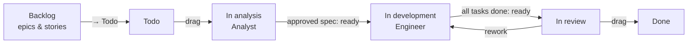

# Flow

**A local pipeline board for working with AI agents.** Write a story, drop it on the board, and an Analyst agent works out the solution with you. An Engineer then builds it, in the same conversation. Every step runs in your own repo, on your own machine, as a tab you can watch in the Herdr desktop app.

## Why Flow

- **One board for all your agent work.** Stories from every project ("space") side by side, in columns that show where each one stands: Todo, In analysis, In development, In review, Done.
- **Drag a card, an agent starts.** Dropping a card on a column opens a tab in herdr-app with the agent for that column (its *persona*), already briefed on the story.
- **From idea to stories.** The Product Owner brainstorms an idea with you and, once you approve its breakdown, writes the epics and stories into your backlogs.
- **The specification is the contract.** The Analyst grills you on the decisions one question at a time and writes a specification with a task checklist. The Engineer implements it task by task and checks tasks off as it goes.
- **One conversation per story.** The Engineer resumes the Analyst's session: it knows what was read, asked and decided, so nobody explores the repo twice.
- **Agents hand over themselves.** When the Analyst is done it asks "Shall I continue with Engineer?". Say yes and the Engineer's tab opens on its own.
- **You see who needs you.** A dot on every card: yellow while its agent works, red when the agent waits for you, green when its step is done. The board updates itself.
- **Plain files, nothing hidden.** Stories live in `.flow/config.json` in your repo, specifications in `.flow/specifications/`, personas in Markdown. Edit them in your editor whenever you like.
- **Local and private.** Flow is one Python process on `127.0.0.1`: no accounts, no cloud service, no database. The agents use whatever model provider you configured in omp.

## How it works



1. **Plan:** create epics and stories in the **Backlog**, a story straight into **Todo** on the Board, or let the **Product Owner** break an idea down into epics and stories.
2. **Analyse:** drag the card to **In analysis**. The Analyst explores the repo, asks you its questions and writes the specification. Your answer to its last question (`per-task` or `autonomous`) approves it.
3. **Build:** the card stays in **In analysis** and turns green: the step is done. Let the Analyst hand over, or drag the card to **In development**. The Engineer implements the tasks.
4. **Review and close:** when every task is done the card in **In development** turns green. Drag it to **Done** to close it: its tabs close and its session is cleaned up.

The agents move the cards themselves with `flow.py status` and mark a finished step with `flow.py ready`. Dragging only starts an agent.

## Requirements

| Tool | What for |
|---|---|
| macOS with the Herdr desktop app (`herdr-app` and `hc` on `PATH`) | the tabs the agents run in |
| [omp](https://github.com/can1357/oh-my-pi) on `PATH` | the coding agent |
| Python 3 (tested with 3.14) | the server and `flow.py`; standard library only |
| Node 24 | only to rebuild the frontend; not needed to run Flow |

## Install

**1. Clone the repo** wherever you like. The commands below assume `~/flow`. The personas call Flow's CLI through `{{flow}}`, so they work from any location.

**2. Install the omp extension** that marks a tab as blocked while an agent waits for your answer:

```sh
python3 ~/flow/app/flow.py install
```

**3. Start Flow** as a terminal in Herdr, so it keeps running when you close the window:

```sh
hc run --bg --keep --no-parent --name sdlc-dashboard python3 ~/flow/app/server.py
```

**4. Open <http://127.0.0.1:8765/>.**

**5. Add your first space:** **Manage → Spaces** in the sidebar, then a **Name** (also the name of its space in herdr-app) and the **Path** of your project folder. Flow creates `<path>/.flow/` and registers the path in `spaces.json`.

That's it. Create an epic and a story, put it in Todo and drag it to **In analysis**.

> Add `.flow/sessions/` to the project's `.gitignore`: it holds the agents' conversations. Commit the rest of `.flow/` if you want your stories and specifications in git.

### Run, stop, update

```sh
hc read sdlc-dashboard                           # log and requests
hc kill sdlc-dashboard && hc rm sdlc-dashboard   # stop
```

- **Another port:** add `--port 8770` after `server.py`.
- **After an update of the repo:** stop and start the server again, and run `flow.py install` again if `omp/extensions/` changed.
- **Changes to `spaces.json` or `.flow/`** made outside Flow (by an agent, a shell or another page) show within a second; changes to `personas/` after reloading the page.
- At startup the server logs inconsistent data as `warning:` (see [Statuses](#statuses)).

## Using Flow

### Backlog

Per space, its epics and stories with their status.

- The **folder icon** next to a space creates an epic; the **list icon** on an epic creates a story; the **pencil** renames or deletes the epic.
- **Drag an epic** by its grip to set its priority: the top epic comes first.
- **Click a story** for its description and specification; **Edit** and **Delete** are in its panel.
- A new story has no specification yet. **→ Todo** creates an empty one and puts the story in Todo on the Board.

### Board

A card per story with a specification, in the column of its status.

- **+ in Todo:** a new story straight into Todo. Pick the space and epic, write the title and description, and the specification is created for you.
- **Click a card** to read the story's description and its specification, with the progress of the tasks.
- **Drag a card** to start the agent of that column. Only the columns you may drop on light up:
  - from Todo to In analysis, or to Done;
  - from In analysis onwards, forward to In development or In review;
  - back from In review to In development (rework).
- **▶ on a card** starts the agent of its own column again with its *Continue* message, e.g. after you closed the tab.
- **Drag to Done** closes the story: its tabs close and its session folder is removed. The specification stays. Done is refused while an agent of the story is still working.
- **The dot** on a card (and next to the status in the Backlog) says where the story stands; hover it for the details:
  - **green:** the step of its column is done (`flow.py ready`), e.g. "Ready for Engineer". It wins over everything else;
  - **yellow:** its agent is working;
  - **red:** its agent waits for you: a question, a permission prompt, the end of its turn or an error;
  - **none:** no tab of the story is open.

  When herdr cannot be reached the header shows **herdr offline** and only green dots remain.
- **The gear** in In analysis, In development and In review edits that column's persona.

### Product Owner

The **Product Owner** button on the right of the header (Backlog and Board) starts an agent that turns an idea into epics and stories.

- **One space selected:** it starts at once, with that space as its *home space*. **Several:** a dialog asks which selected space is home.
- It asks for your idea, explores the backlogs and code involved, and brainstorms with you one question at a time, in the same form as the Analyst.
- It proposes the complete breakdown (per epic: space, new or existing epic; per story: title, description, labels) and writes nothing until you approve it. Then one `flow.py breakdown` call adds everything at once.
- New epics go to the home space; another space from `spaces.json` only when the breakdown says so.
- Each story's description has three short parts: **Why**, **Scope** (in and out) and **For analysis** (questions left for the Analyst). The stories stay on `waiting-for-analysis`, without a specification.
- The result shows as a toast: started, or the running Product Owner opened. Without `personas/product-owner.md` the button is disabled.

### Spaces in the sidebar

Check the spaces you want to see; Backlog and Board show exactly those. **Only** shows a single space, the icon next to **Spaces** shows them all. Flow remembers your choice.

## Agents

### Sessions in Herdr

Starting an agent opens a tab named `<story> · <Persona>`, e.g. `E5S4 · Engineer`, in the herdr space with the name of your space, in the folder of the space. The Product Owner's tab is named after the persona, `Product Owner`, in the herdr space of its home space.

- **One conversation per story:** every column persona runs `omp --session-dir <path>/.flow/sessions/<story>` and continues the conversation that is already there. Role and model are fixed when `omp` starts, so a persona switch closes the old tab and opens a new one.
- **Already open?** Flow selects the tab instead of starting a second one.
- **Still working?** A new persona does not start while the story's previous agent is still busy. The card says which tab.
- **The Product Owner** has one tab per home space and starts a fresh `omp` conversation each time it opens (no session folder). It never closes story tabs, and Done never closes it.

### Personas

A persona is `personas/<key>.md`. The keys are the columns **In analysis**, **In development** and **In review**, plus `product-owner`, which belongs to no column.

| File | Persona | What it does |
|---|---|---|
| `in-analysis.md` | Analyst | Grills you on the decisions, writes the specification, marks the story ready once you approve. |
| `in-development.md` | Engineer | Implements the specification task by task, marks the story ready when everything is done. |
| `in-review.md` | (none yet) | |
| `product-owner.md` | Product Owner | Breaks an idea down into epics and stories with you; writes them with `flow.py breakdown` after your approval. |

Edit a persona on the **Personas** page, in your editor, or for a column with the gear on the Board:

```markdown
---
name: Engineer
model:            # empty = your default model in omp, otherwise e.g. opus
---

## Role
The system prompt for the whole session.

## Start
The first message when a card is dropped on this column.

## Continue
Optional: the first message for ▶ on a card in this column.
```

A column persona can use these variables in all three sections:

| Variable | Value |
|---|---|
| `{{specification_path}}` | full path of the specification |
| `{{specification_title}}` | its title |
| `{{story_id}}` | the story ID |
| `{{path}}` | the folder of the space, where the session starts |
| `{{config_file}}` | full path of the space's `.flow/config.json` |
| `{{execution}}` | `per-task` or `autonomous` |
| `{{from}}` | the column the card came from |
| `{{flow}}` | the command that runs Flow's CLI, `python3 <checkout>/app/flow.py` |

The Product Owner has no Continue section and its own variables:

| Variable | Value |
|---|---|
| `{{path}}` | the folder of the home space, where the session starts |
| `{{config_file}}` | full path of the home space's `.flow/config.json` |
| `{{spaces_file}}` | full path of `spaces.json`, the spaces it may write to |
| `{{flow}}` | the command that runs Flow's CLI, `python3 <checkout>/app/flow.py` |

**Handover.** Flow adds a fixed paragraph to the Role of the Analyst and the Engineer. When their step is done (`flow.py ready`) and the next column has a persona, they ask "Shall I continue with \<Persona\>?" and on yes run `flow.py next`. In review gets nothing: its next step is Done, which is yours.

The dashboard saves a persona only with a name, role and start, and refuses unknown variables (including another persona's) and a Continue for the Product Owner. A persona file with extra sections can only be edited in your editor, so nothing gets lost.

### Questions from the Analyst

The Analyst asks one question at a time, always in the same form:

```markdown
### Q3 · Delete semantics
**Context:** what in the repo or an earlier answer this decision rests on.

**Question:** the decision in one sentence.

**Suggestion:** its answer, or the choices A/B/C with its pick marked.
```

Answer with a letter, "yes", or your own words. The extension from `flow.py install` marks the tab as **blocked** in Herdr while the question is open, with the question as its message. It relies on how omp reports its status, not on a documented API. If a question ever shows as *done* after an omp update, the extension needs updating.

## Commands for agents

The personas use `flow.py`; you can run it yourself too. Errors go to stderr with exit code 1, and nothing changes.

| Command | What it does |
|---|---|
| `flow.py status <space-path> <story-id> <status>` | Sets a story's status in `config.json`, with the same rules as the dashboard. Clears `ready`. |
| `flow.py ready <space-path> <story-id>` | Marks the step of a story in In analysis, In development or In review as done: `"ready": true`, a green dot. A status change or a newly started agent clears it; selecting an already open tab does not. |
| `flow.py next <space-path> <story-id>` | Hands a ready story to the persona of the next column (In analysis → In development, In development → In review), exactly like a drag. From an agent's tab it waits until that agent's turn has ended (outcome in `.flow/sessions/<story>/next.log`). From a shell it starts at once. |
| `flow.py install` | Copies `omp/extensions/*.ts` into `~/.omp/agent/extensions` (or `$PI_CODING_AGENT_DIR/extensions`). Prints `installed`, `updated` or `unchanged` per file; other extensions stay. Run it again after the extensions change. |
| `flow.py breakdown` | Adds an approved breakdown, read as JSON from stdin, as epics and stories to any registered spaces. See below. |

All five live at `python3 <checkout>/app/flow.py`; a persona writes `{{flow}}`.

### `flow.py breakdown`

The Product Owner's one write. It reads the breakdown from stdin:

```json
{"epics": [
  {"space": "~/Projects/shop", "title": "Checkout", "stories": [
    {"title": "Pay with iDEAL", "description": "**Why** …\n\n**Scope** …\n\n**For analysis** …", "labels": ["payments"]}
  ]},
  {"space": "~/Projects/shop", "epic": "E3", "stories": [{"title": "Show the order number"}]}
]}
```

- `space`: the path of a space in `spaces.json` (`~` allowed).
- Exactly one of `epic` (add to that existing epic) or `title` (a new epic), and at least one story.
- A story has a `title`, and optionally a markdown `description` and `labels` (lowercase letters, digits, dashes). It gets the next `E<n>S<m>` and goes on `waiting-for-analysis`, without a specification.

Every entry is checked first; one error (unregistered space, unknown epic, empty title, bad label, …) writes nothing and names the entry, e.g. `Epic 2, story 1: Title is empty`. Then each space's `config.json` is written once and the created IDs are printed, one line per space:

```
Shop: E7 Checkout (E7S1); E3 (+E3S4)
```

Like `status`, it does not hold the dashboard's lock: an open dashboard shows the new stories within a second, and a change it was making to that space gets "changed in the meantime".

## Your data

```
flow/spaces.json                 the registry: the paths of your spaces (not in git)
flow/personas/<key>.md           the personas: one per column, and product-owner.md

<space>/.flow/
  config.json                    the space: name, epics and stories
  specifications/                one specification per story
  sessions/<story>/              the story's agent conversation; removed on Done
```

### `spaces.json`

Only the paths, as typed (`~` allowed): `[{ "path": "~/Projects/shop" }]`. A path without `.flow/config.json` is skipped with a warning.

### `.flow/config.json`

```json
{
  "schemaVersion": 2,
  "space": { "id": "shop", "name": "Shop", "nextEpic": 2 },
  "epics": [
    { "id": "E1", "title": "Checkout", "nextStory": 2, "stories": [
      { "id": "E1S1", "title": "Pay by card", "description": "…", "status": "in-analysis", "ready": true,
        "labels": ["payments"], "specification": "2026-11-10-e1s1-pay-by-card-specification.md" }
    ] }
  ]
}
```

- **IDs:** new epics get `E<n>`, stories `E<n>S<m>`. Existing IDs such as `SET-05` stay. Numbers are never reused.
- **Labels:** lowercase letters, digits and dashes.
- **Fields Flow doesn't know** (notes, context, …) are kept on every change.
- **`ready`:** only present (and `true`) while the step of the story's column is done; see `flow.py ready`.
- **Edited elsewhere?** When `config.json` changed since the page loaded, the dashboard refuses the change. Reload and try again.

### Statuses

| Status | Column | Has a specification |
|---|---|---|
| `waiting-for-analysis` | (Backlog only) | no |
| `todo` | Todo | yes |
| `in-analysis` | In analysis | yes |
| `in-development` | In development | yes |
| `in-review` | In review | yes |
| `done` | Done | optional |

Todo is a queue without an agent. A finished step keeps its column and gets `ready`: the green dot.

### Specification

`.flow/specifications/YYYY-MM-DD-<story-id>-<title>-specification.md`, starting with:

```markdown
---
execution: per-task
---

# <Feature> (<story-ID>) Specification
```

`per-task` makes the Engineer stop after each task for your review; `autonomous` keeps it going until everything is done or something blocks. The checklist at the end (`- [ ] Task N: …`) drives the progress on the card.

## Development

```
app/        server.py (API + page), sdlc.py (domain), session.py (starting a persona),
            herdr.py (herdr-app and hc), live.py (live updates), flow.py (CLI),
            static/ (built frontend), tests/
web/        the frontend: React, Tailwind, shadcn/ui; builds into app/static/
omp/        omp extensions, installed with flow.py install
personas/   the personas
```

**Tests:**

```sh
cd ~/flow && python3 -m unittest discover app/tests
cd ~/flow/web && npm test
```

**Frontend:** `app/static/` is the build of `web/` and is committed, so running Flow needs no Node. After a change in `web/`:

```sh
cd ~/flow/web && npm install && npm run build
```

Then reload the page; the server doesn't need a restart. `npm run dev` (<http://127.0.0.1:5173/>) has no API behind it, so test against the built page.

**Naming:** the product is called Flow, but identifiers stay `sdlc` (`X-SDLC-Token`, the `sdlc.*` localStorage keys, the `sdlc-dashboard` terminal) so running setups keep working.

### API

All endpoints are under `http://127.0.0.1:8765`. Writes need the page's `Origin` and the `X-SDLC-Token` from `<meta name="sdlc-token">`, and carry the space's `version`: a stale version gets 409.

| Endpoint | What |
|---|---|
| `GET /api/meta` | columns, statuses, task states, `personaColumns` (the Board), `personaKeys` (all personas), `personaVariables` per key, allowed moves, `todoColumn`, `doneColumn` |
| `GET /api/spaces` · `POST /api/spaces` | list spaces · create one (`{"name", "path"}`) |
| `GET /api/spaces/{id}` | a space with epics, stories and `version` |
| `POST /api/spaces/{id}/epics` | create an epic |
| `PATCH` · `DELETE /api/spaces/{id}/epics/{epic}` | rename or reorder (`position`) · delete with its stories and specifications |
| `POST /api/spaces/{id}/epics/{epic}/stories` | create a story (on `waiting-for-analysis`) |
| `PATCH` · `DELETE /api/spaces/{id}/stories/{story}` | edit · delete with its specification |
| `GET /api/spaces/{id}/deletion?epic=…` or `?story=…` | what a delete would remove |
| `GET /api/specifications` | the cards of the Board, each with `status` and `ready` |
| `GET` · `POST /api/spaces/{id}/stories/{story}/specification` | read with rendered HTML · create an empty one and put the story in Todo |
| `POST …/specification/start` | `{"from", "to"}`: start the persona of `to` (409 busy or moved, 422 not allowed, 502 herdr-app failed) |
| `POST …/specification/complete` | `{"from"}`: close the tabs, remove the session, set `done` |
| `POST /api/spaces/{id}/product-owner` | start the Product Owner with `{id}` as home space, or select its open tab: `{result, space, tab}` (404 unknown space, 422 no or invalid persona, 502 herdr-app failed) |
| `GET /api/personas` · `PUT` · `DELETE /api/personas/{key}` | read · save · delete a persona (`key`: a persona column or `product-owner`) |
| `GET /api/events` | server-sent events: `agents` (`{available, agents: {"<space>\|<story>": {persona, state}}}`, first on connect and on every change in herdr) and `changed` (a watched file changed: reload). A `: keep-alive` comment every 15 s |

**Security:** the server listens on `127.0.0.1` only, accepts no other `Host` header and sends no CORS headers. The token is new on every start and only lives in the page. All writes go through one lock.

## License

[MIT](LICENSE)
